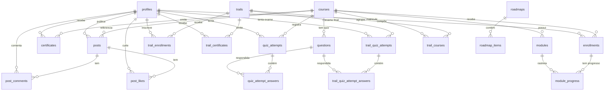

# Modelagem do Banco de Dados

Persistência em **PostgreSQL** via **Prisma ORM** (`backend/prisma/schema.prisma`). Todas as PKs
são `UUID` (exceto `ApiToken`, que usa `cuid()`), com integridade referencial, índices de
performance e deletes em cascata.

> **Fonte da verdade**: `backend/prisma/schema.prisma` (24 models). Este documento espelha o
> schema atual. Autenticação é **somente e-mail + senha (bcrypt)** — **não há Google OAuth**.

---

## Diagrama de Relacionamentos (ERD)

---

## Models

### Usuários e acesso

- **`Profile`** (`profiles`) — usuários da plataforma.
  Campos: `name`, `email` (unique), `business` (`""` default), `phone?`, `passwordHash` (bcrypt),
  `groupType` (`"vip"`|`"embaixador"`, default `embaixador`), `tier` (default `"Embaixador Voice"`),
  `xp` (0), `level` (1), `isAdmin` (false), `isActive` (true), `newsletter` (false),
  `profileImage?`, `resetPasswordToken?`, `resetPasswordExpiry?`, `createdAt`.

- **`UserRole`** (`user_roles`) — `roleName` (unique). Tabela auxiliar de papéis.

- **`GroupRule`** (`group_rules`) — faixas de XP por nível: `groupType`, `tier`, `minXp`,
  `maxXp?` (null = sem teto), timestamps. Gerenciado em `/admin/grupos`.

- **`SystemSetting`** (`system_settings`) — `key` (unique) / `value` (string), `updatedAt`.
  Ex.: logos por tema, `show_user_photos`.

- **`ApiToken`** (`api_tokens`) — PK `cuid()`. `name`, `tokenHash` (SHA256 unique), `lastUsedAt?`,
  `expiresAt?`, `isActive` (true), `createdById`, timestamps. Token nunca persistido em claro.

- **`XpRule`** (`xp_rules`) — `action` (unique), `label`, `description?`, `xpValue` (int),
  `icon?`, `isActive` (true), `updatedAt`. Regras iniciais: `post` (10 XP), `trail_exam` (100 XP).
  Editável via `PUT /admin/gamification/rules/:id`.

---

### Cursos e progresso

- **`Course`** (`courses`) — `title`, `description?`, `workloadHours` (0), `xpReward` (50),
  `coverUrl?`, `targetGroup` (`all`|`vip`|`embaixador`, default `all`), `isPublished` (false),
  `createdAt`.

- **`Module`** (`modules`) — aula. `courseId?` (cascade), `title`, `description?`, `content?`,
  `videoUrl?`, `duration?` (default `"10:00"`), `sortOrder` (0). Índice em `courseId`.

- **`Enrollment`** (`enrollments`) — matrícula. `userId?`, `courseId?`, `enrolledAt`,
  `completedAt?`. **`@@unique([userId, courseId])`**, índices em ambos.

- **`ModuleProgress`** (`module_progress`) — `enrollmentId?`, `moduleId?`, `isCompleted` (false),
  `completedAt?`. **`@@unique([enrollmentId, moduleId])`**.

- **`Certificate`** (`certificates`) — `userId?`, `courseId?`, `verificationCode` (unique,
  `UNISURI-[HEX]` / `UNISURI-MAN-[HEX]`), `issuedAt`.

---

### Quizzes

- **`Question`** (`questions`) — `courseId` (cascade), `text`, `options` (`Json`), `answer`
  (string da opção correta), `createdAt`. Compartilhada entre quiz de curso e exame de trilha.

- **`QuizAttempt`** (`quiz_attempts`) — `userId`, `courseId`, `score` (float), `passed`,
  `attemptNumber`, `createdAt`. → `QuizAttemptAnswer` (`selectedOption`, `isCorrect`).

- **`QuizExtraAttempt`** (`quiz_extra_attempts`) — tentativa extra concedida por admin:
  `userId`, `courseId`, `grantedBy`, `used` (false), `grantedAt`.

---

### Trilhas

- **`Trail`** (`trails`) — `name`, `description?`, `targetGroup` (default `all`), `sortOrder`.

- **`TrailCourse`** (`trail_courses`) — vínculo curso↔trilha, `sortOrder`.
  **`@@unique([trailId, courseId])`**.

- **`TrailEnrollment`** (`trail_enrollments`) — `userId`/`trailId`. **`@@unique([userId, trailId])`**.

- **`TrailCertificate`** (`trail_certificates`) — `verificationCode` unique (`SURI-TR-[HEX]`).

- **`TrailQuizAttempt`** (`trail_quiz_attempts`) — exame final: `score`, `passed`,
  `attemptNumber`. → `TrailQuizAttemptAnswer`.

---

### Comunidade

- **`Post`** (`posts`) — `authorId` (cascade), `courseId?`, `title`, `body`, `mediaType?`,
  `mediaUrl?`, `createdAt`.

- **`PostLike`** (`post_likes`) — `postId`/`userId`. **`@@unique([postId, userId])`**.

- **`PostComment`** (`post_comments`) — `postId`, `userId`, `content`, `createdAt`.

---

### Roadmaps (conteúdo curado)

- **`Roadmap`** (`roadmaps`) — `title`, `description?`, `isActive` (true), `sortOrder`, timestamps.

- **`RoadmapItem`** (`roadmap_items`) — `roadmapId` (cascade), `type`
  (`video`|`document`|`reference`), `title`, `url`, `description?`, `sortOrder`.

---

## Integridade de Dados

- **Deletes em cascata**: remover um curso apaga módulos, matrículas, progressos, questões,
  tentativas e certificados vinculados. Padrão `onDelete: Cascade`.
- **Restrições únicas**: matrícula por (user, course); progresso por (enrollment, module);
  like por (post, user); curso por trilha; `verificationCode` e `tokenHash` únicos.
- **`@map`/`@@map`**: nomes de colunas/tabelas em `snake_case` no banco; camelCase no Prisma.

---

## Relacionado

- Regras de negócio sobre estes dados: `business-rules.md`
- Quizzes e exames de trilha em detalhe: `quizzes-trilhas.md`
- Tokens de API e endpoints externos: `api-externa.md`
