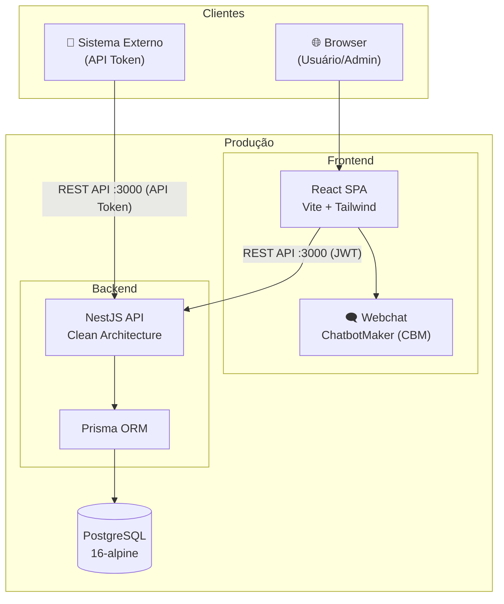
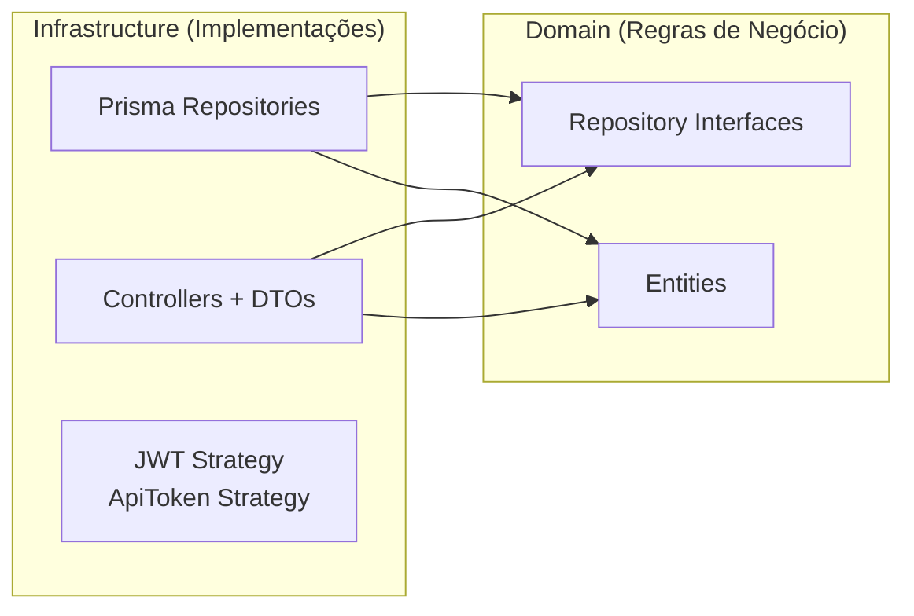
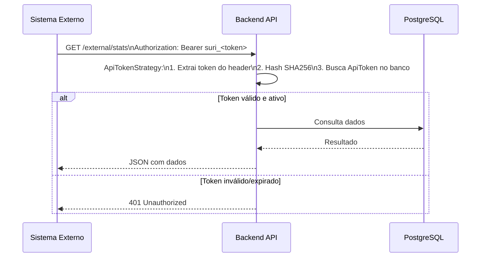
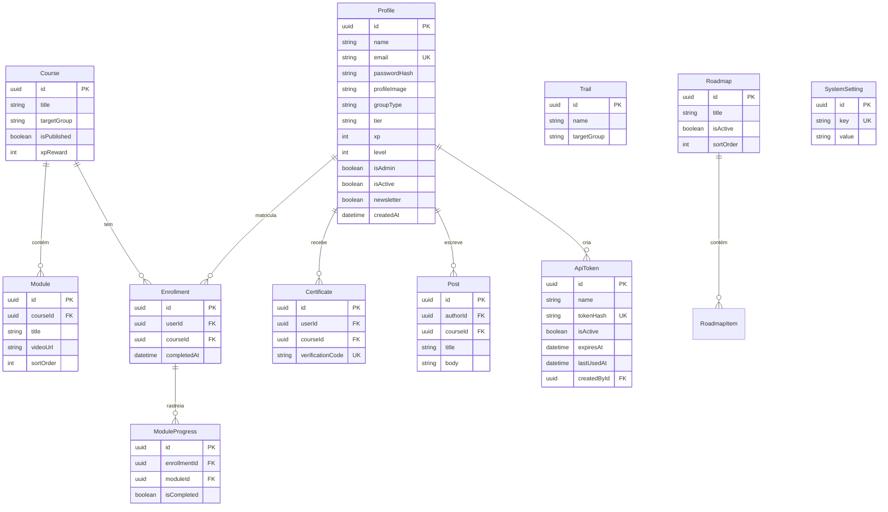
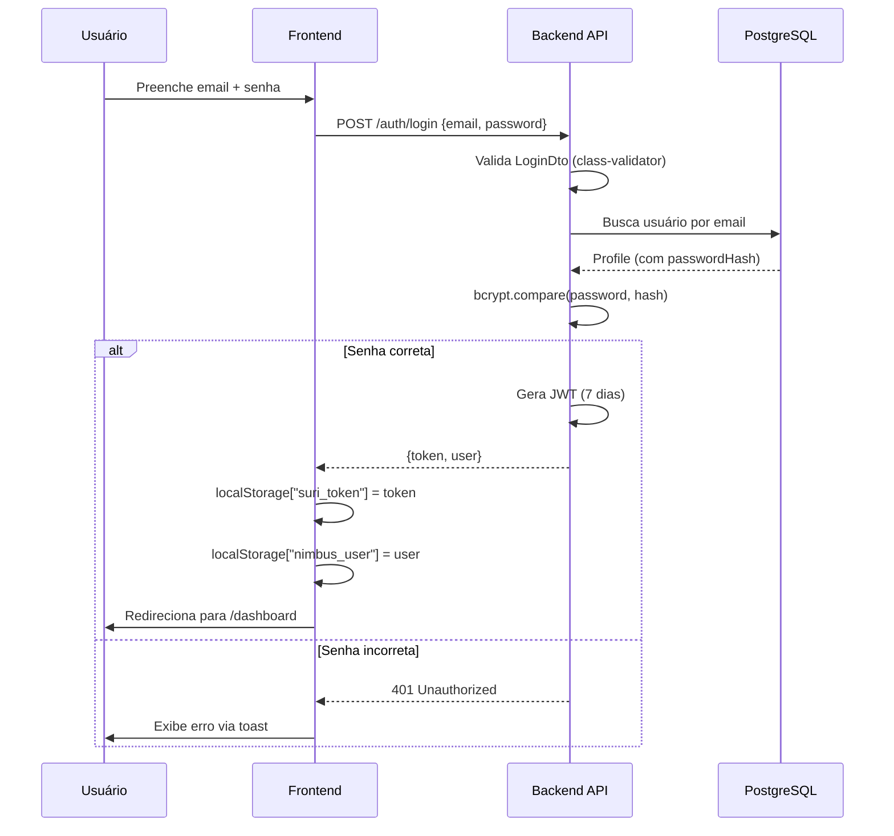

# Arquitetura — Universidade Suri

> Visão geral da arquitetura técnica da plataforma.

---

## Visão Geral

A Universidade Suri é uma plataforma EAD com gamificação e comunidade social. A arquitetura segue o padrão **monorepo** com dois projetos independentes:

```
universidade-suri/
├── backend/      → API REST (NestJS + Prisma + PostgreSQL)
├── frontend/     → SPA (React + Vite + Tailwind + shadcn/ui)
├── docs/         → Documentação técnica
└── docker-compose.yml
```

---

## Diagrama de Arquitetura



---

## Backend — Clean Architecture

O backend segue **Clean Architecture** com separação em camadas:



### Camadas

| Camada | Pasta | Responsabilidade |
|---|---|---|
| **Feature Modules** | `src/<feature>/` | Uma pasta por domínio: `*.module.ts` + `*.controller.ts` (fino) + `*.service.ts` (lógica) |
| **Domain** | `src/domain/entities/` | Entidades de negócio (User, Course, Post, Certificate) |
| **Domain** | `src/domain/repositories/` | Interfaces/contratos dos repositórios |
| **Infrastructure** | `src/infrastructure/database/` | PrismaService (+ PrismaModule @Global) + repositórios concretos |
| **Infrastructure** | `src/infrastructure/storage/` | StorageModule (@Global) + SupabaseStorageService |
| **Infrastructure** | `src/infrastructure/http/dtos/` | DTOs com class-validator |
| **Infrastructure** | `src/infrastructure/http/strategies/` | JwtStrategy + ApiTokenStrategy (Passport.js) |
| **Infrastructure** | `src/infrastructure/http/guards/` | ApiTokenGuard |
| **Bootstrap** | `src/main.ts` | CORS, Helmet, ValidationPipe, Swagger, body limit |
| **Config** | `src/app.module.ts` | Importa infra global + todos os feature modules |

> **Feature modules**: cada domínio é isolado em `src/<feature>/`. O controller apenas delega
> ao service; a lógica de negócio e a autorização ficam no service. Repositório dedicado onde
> há CRUD claro; features de agregação/leitura/config usam `PrismaService` direto no service.

### Repositórios

| Interface | Implementação | Descrição |
|---|---|---|
| `IUserRepository` | `PrismaUserRepository` | CRUD de perfis, leaderboard, auth (AuthModule) |
| `ICourseRepository` | `PrismaCourseRepository` | Cursos, aulas (CoursesModule, CertificatesModule, QuizModule) |
| `IPostRepository` | `PrismaPostRepository` | Posts, likes, comentários da comunidade (PostsModule) |
| `IRoadmapRepository` | `PrismaRoadmapRepository` | Roadmaps e itens (RoadmapsModule) |
| `IInstructorRepository` | `PrismaInstructorRepository` | Instrutores + associação a cursos (InstructorsModule) |

### Feature Modules e Controllers

| Feature Module | Controller(s) | Prefixo | Auth | Descrição |
|---|---|---|---|---|
| `AuthModule` | `AuthController` | `/auth` | JWT | Login, signup, perfil, usuários |
| `CoursesModule` | `CoursesController` | `/courses` | JWT / Admin | CRUD de cursos e aulas |
| `EnrollmentsModule` | `EnrollmentsController` | `/enrollments` | JWT | Matrículas e progresso |
| `CertificatesModule` | `CertificatesController` | `/certificates` | JWT / Admin | Emissão e validação |
| `QuizModule` | `QuizController` | `/quiz` | JWT / Admin | Questões e tentativas |
| `TrailsModule` | `TrailsController` | `/trails` | JWT / Admin | Trilhas e exame final |
| `PostsModule` | `PostsController` | `/posts` | JWT | Comunidade de projetos |
| `RoadmapsModule` | `RoadmapsController` | `/roadmaps` | JWT / Admin | Roadmaps de aprendizado |
| `SettingsModule` | `SettingsController` | `/settings` | Público / Admin | Configurações globais e logos |
| `GamificationModule` | `GamificationController` | `/gamification`, `/admin/gamification` | JWT / Admin | XpRules e GroupRules |
| `InstructorsModule` | `InstructorsController` | `/instructors`, `/admin/instructors` | Público / Admin | Instrutores + associação a cursos |
| `ChangelogModule` | `ChangelogController` | `/changelog` | Público | Versões da plataforma |
| `AdminModule` | `AdminGroupsController` | `/admin/groups` | Admin | Regras de tier por XP |
| `AdminModule` | `AdminReportsController` | `/admin/reports` | Admin | Relatórios analíticos |
| `AdminModule` | `AdminApiTokenController` | `/admin/api-tokens` | Admin | Gerenciar tokens de API externa |
| `ExternalApiModule` | `ExternalApiController` | `/external` | API Token | Endpoints para sistemas externos |

---

## API Externa (Integração com Sistemas Externos)

O backend expõe um conjunto separado de endpoints (`/external/*`) autenticado por **token de API** (não JWT), permitindo integração com sistemas externos como CRMs, painéis e automações.



### Endpoints da API Externa

| Método | Rota | Descrição |
|---|---|---|
| GET | `/external/stats` | Totais: usuários, cursos, trilhas, matrículas, certificados |
| GET | `/external/leaderboard` | Top usuários por XP (`?limit=50&groupType=embaixador`) |
| GET | `/external/users` | Listagem com filtros avançados |
| GET | `/external/users/newsletter` | Assinantes da newsletter |
| GET | `/external/users/:id` | Detalhes completos de um usuário |
| GET | `/external/courses` | Cursos (`?all=true` inclui não-publicados) |
| GET | `/external/courses/:id` | Detalhes com módulos e contadores |
| GET | `/external/trails` | Trilhas com contadores |
| GET | `/external/trails/:id` | Detalhes com cursos da trilha |
| GET | `/external/enrollments` | Matrículas com filtros (`?userId&courseId&completed`) |
| GET | `/external/enrollments/user/:userId` | Matrículas de um usuário |
| GET | `/external/enrollments/course/:courseId` | Matrículas de um curso |
| GET | `/external/certificates` | Certificados com filtros |
| GET | `/external/certificates/validate/:code` | Validação pública de certificado |
| GET | `/external/certificates/user/:userId` | Certificados (cursos + trilhas) de um usuário |

---

## Webchat (Balão de Suporte)

O frontend integra o **ChatbotMaker (CBM)** como canal de suporte via widget flutuante.

```
index.html
└── <script> window.cbAsyncInit
    ├── CBM.ChatbotId = "cb11077427"
    ├── Lê dados do usuário de localStorage["nimbus_user"]
    └── CBM.StartWebChat(chatUser, false, null)
```

### Comportamento por dispositivo

| Dispositivo | Comportamento |
|---|---|
| **Desktop** | Botão flutuante visível com opacidade 0.45 → 1.0 no hover |
| **Mobile** | Botão flutuante oculto quando fechado; acesso via ícone `MessageCircle` no header; quando aberto, reposicionado acima da bottom nav (`bottom: 80px`) |

O botão no header mobile faz `document.querySelector('.__talkjs_launcher')?.click()` para acionar o widget.

---

## Modelo de Dados (Principais Entidades)



> Diagrama simplificado. Ver `docs/project-architecture.md` para referência completa de todos os modelos.

---

## Frontend — Estrutura

```
frontend/src/
├── App.tsx                  # Router principal com guards de auth e admin
├── main.tsx                 # Entry point (React DOM + providers)
├── components/
│   ├── ui/                  # Componentes shadcn/ui (Button, Card, Switch, Dialog...)
│   ├── app-shell.tsx        # Layout: sidebar desktop + header mobile + navegação + botão webchat
│   ├── UserAvatar.tsx       # Avatar de usuário (foto ou iniciais, controlado por setting)
│   └── QuizModal.tsx        # Modal de quiz de curso
├── pages/
│   ├── Landing.tsx          # Página pública de apresentação
│   ├── Login.tsx / SignUp.tsx
│   ├── Dashboard.tsx        # Home: stats, cursos em andamento, top ranking
│   ├── CoursesList.tsx      # Listagem de cursos disponíveis
│   ├── CoursePlayer.tsx     # Player + quiz + aba comunidade do curso
│   ├── Leaderboard.tsx      # Ranking com fotos ou iniciais
│   ├── Roadmap.tsx          # Roadmaps (polling 30s para tempo real)
│   ├── TrailsList.tsx       # Trilhas de aprendizado
│   ├── Profile.tsx          # Perfil, certificados, histórico
│   ├── Settings.tsx         # Configurações pessoais + links admin
│   ├── Certificate.tsx      # Certificado público por código
│   ├── AdminPanel.tsx       # Usuários + toggle de fotos de perfil
│   ├── AdminCourses.tsx     # CRUD de cursos e aulas
│   ├── AdminRoadmap.tsx     # CRUD de roadmaps
│   ├── AdminApiTokens.tsx   # Gerenciar tokens de API externa
│   └── (AdminGroups, AdminReports, AdminLogos, AdminQuizzes, AdminNewsletter)
├── lib/
│   ├── api.ts               # apiRequest() e apiUpload() com Bearer token
│   ├── auth.tsx             # AuthProvider: login, logout, signup, refreshProfile
│   ├── settings.tsx         # SettingsProvider: configurações globais com polling 60s
│   └── theme.tsx            # ThemeProvider: dark/light mode
├── hooks/
│   ├── useCachedRequest.ts  # Cache GET com TTL (Map global, limpo no logout)
│   └── use-mobile.tsx       # Detecta viewport mobile
└── styles.css               # Tokens CSS, animações, breakpoints mobile
```

### Rotas

| Rota | Página | Acesso |
|---|---|---|
| `/` | Landing | 🌐 Público |
| `/login` | Login | 🌐 Público |
| `/signup` | Cadastro | 🌐 Público |
| `/certificado/:codigo` | Verificação | 🌐 Público |
| `/dashboard` | Dashboard | 🔒 Autenticado |
| `/cursos` | Lista de cursos | 🔒 Autenticado |
| `/cursos/:courseId` | Player do curso | 🔒 Autenticado |
| `/ranking` | Leaderboard | 🔒 Autenticado |
| `/roadmap` | Roadmaps | 🔒 Autenticado |
| `/trilhas` | Trilhas | 🔒 Autenticado |
| `/perfil` | Perfil | 🔒 Autenticado |
| `/configuracoes` | Configurações | 🔒 Autenticado |
| `/admin` | Painel admin | 🔒 Admin |
| `/admin/cursos` | Gerenciar cursos | 🔒 Admin |
| `/admin/roadmap` | Gerenciar roadmaps | 🔒 Admin |
| `/admin/api-tokens` | Tokens de API | 🔒 Admin |

---

## Fluxo de Autenticação



---

## Gamificação

| Conceito | Descrição |
|---|---|
| **XP** | Ganho ao completar módulos, cursos e passar em exames de trilha (+200 XP) |
| **Level** | 1 nível por 1000 XP acumulados (`Math.floor(xp / 1000) + 1`) |
| **Tier** | Classificação especial definida por regras de XP em `GroupRule` |
| **Certificado de Curso** | Emitido ao completar 100% + passar no quiz (código `UNISURI-XXXXXX`) |
| **Certificado de Trilha** | Emitido ao passar no exame final (≥70%), código `SURI-TR-XXXXXX` |
| **Admin** | Não acumula XP (`addXp()` retorna sem efeito para admins) |

---

## Stack Tecnológico

| Componente | Tecnologia |
|---|---|
| Frontend Framework | React 18 + TypeScript |
| Build Tool | Vite (porta 5175) |
| CSS Framework | Tailwind CSS v4 |
| UI Components | shadcn/ui |
| Roteamento | React Router v6 |
| Webchat | ChatbotMaker (CBM) via `webchat.chatbotmaker.io/cbm-jssdk.js` |
| Backend Framework | NestJS 10 |
| ORM | Prisma 5 |
| Database | PostgreSQL 16 |
| Auth (usuários) | JWT 7d + Passport.js + bcrypt(10) |
| Auth (API externa) | Token SHA256 + `passport-custom` |
| Segurança | helmet, @nestjs/throttler, class-validator |
| API Docs | Swagger (`/api/docs`) |
| Container | Docker + Docker Compose |

---

## Referências

- [Documentação Técnica Detalhada](project-architecture.md)
- [Guia de Segurança](security.md)
- [Guia de Deploy](deploy-guide.md)
