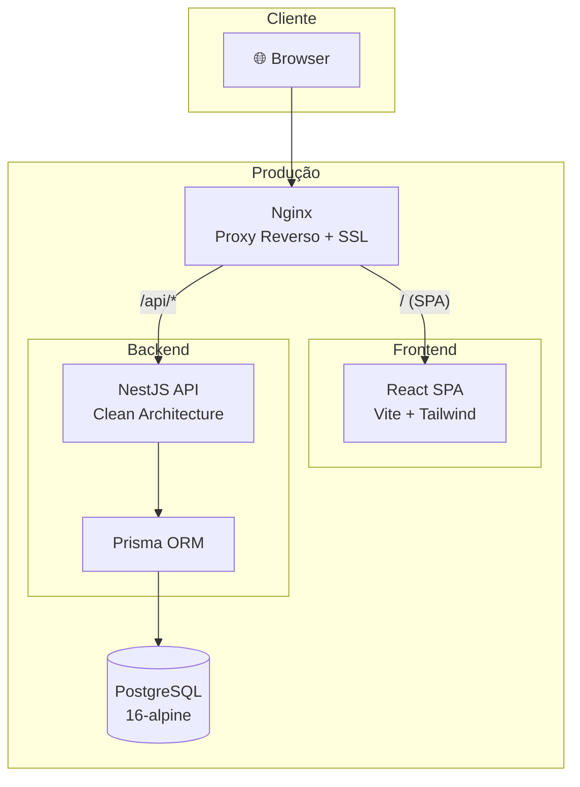
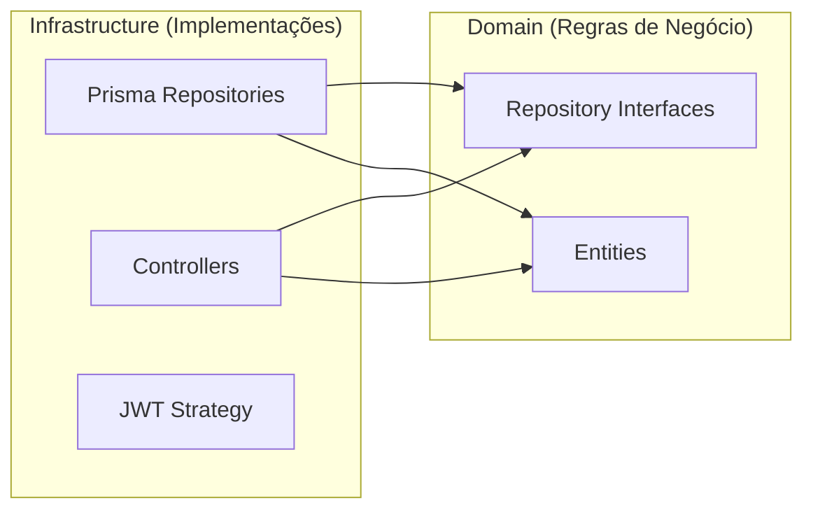
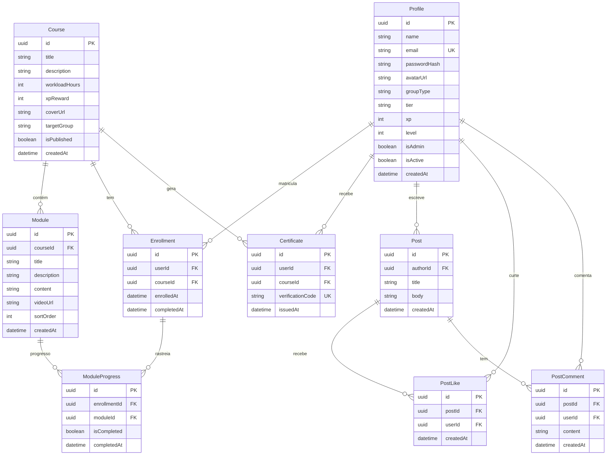
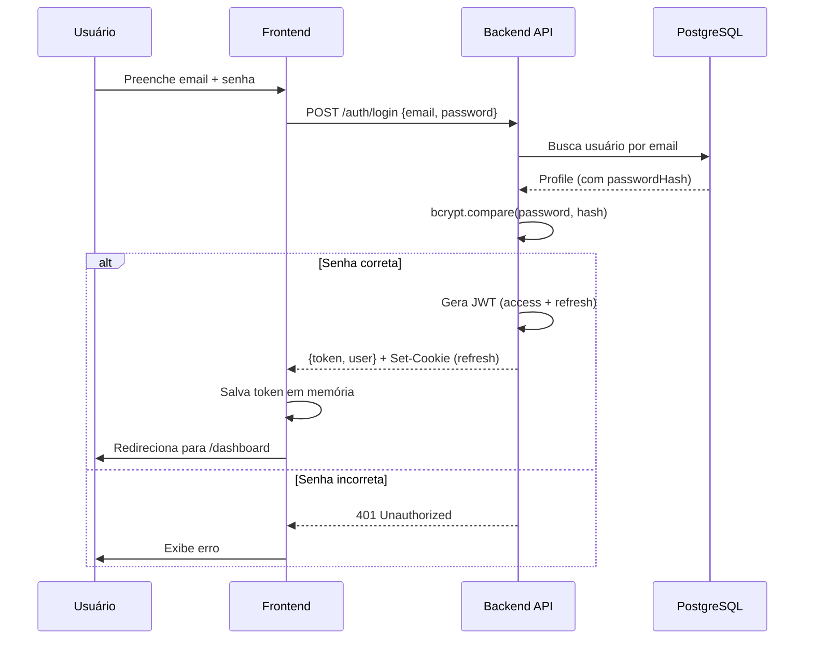

# Arquitetura — Universidade Suri

> Visão geral da arquitetura técnica da plataforma.

---

## Visão Geral

A Universidade Suri é uma plataforma EAD com gamificação e comunidade social. A arquitetura segue o padrão **monorepo** com dois projetos independentes:

```
universidade-suri/
├── backend/      → API REST (NestJS + Prisma + PostgreSQL)
├── frontend/     → SPA (React + Vite + Tailwind + shadcn/ui)
├── nginx/        → Proxy reverso de produção
└── docs/         → Documentação técnica
```

---

## Diagrama de Arquitetura



---

## Backend — Clean Architecture

O backend segue **Clean Architecture** com separação em camadas:



### Camadas

| Camada | Pasta | Responsabilidade |
|---|---|---|
| **Domain** | `src/domain/entities/` | Entidades de negócio (User, Course, Post, Certificate) |
| **Domain** | `src/domain/repositories/` | Interfaces/contratos dos repositórios |
| **Infrastructure** | `src/infrastructure/database/` | PrismaService + implementações concretas dos repositórios |
| **Infrastructure** | `src/infrastructure/http/controllers/` | Controllers REST (auth, courses, enrollment, certificate, post) |
| **Infrastructure** | `src/infrastructure/http/strategies/` | JWT authentication strategy (Passport.js) |
| **Bootstrap** | `src/main.ts` | Configuração de CORS, Swagger, porta |
| **Config** | `src/app.module.ts` | Wiring de DI (bind interfaces → implementações) |

### Entidades do Domínio

| Entidade | Arquivo | Descrição |
|---|---|---|
| `User` | `user.entity.ts` | Perfil do usuário com XP, nível, tier |
| `Course` | `course.entity.ts` | Curso com módulos e recompensa XP |
| `Post` | `post.entity.ts` | Post da comunidade com likes e comentários |
| `Certificate` | `certificate.entity.ts` | Certificado com código de verificação |

### Repositórios

| Interface | Implementação | Descrição |
|---|---|---|
| `IUserRepository` | `PrismaUserRepository` | CRUD de perfis e autenticação |
| `ICourseRepository` | `PrismaCourseRepository` | Cursos, módulos, matrículas, certificados |
| `IPostRepository` | `PrismaPostRepository` | Posts, likes, comentários da comunidade |

---

## Modelo de Dados



---

## Frontend — Estrutura

```
frontend/src/
├── App.tsx              # Router principal com rotas protegidas
├── main.tsx             # Entry point (React DOM + providers)
├── components/
│   ├── ui/              # Componentes shadcn/ui (Button, Card, Dialog...)
│   ├── app-shell.tsx    # Layout com Navbar e Sidebar
│   └── AvatarCreator.tsx
├── pages/               # Uma página por rota
│   ├── Login.tsx
│   ├── SignUp.tsx
│   ├── Dashboard.tsx
│   ├── CoursesList.tsx
│   ├── CoursePlayer.tsx
│   ├── Community.tsx
│   ├── Leaderboard.tsx
│   ├── Profile.tsx
│   ├── Settings.tsx
│   ├── AdminPanel.tsx
│   ├── Certificate.tsx
│   └── Projects.tsx
├── lib/
│   ├── api.ts           # Client HTTP (fetch wrapper)
│   ├── auth.tsx         # AuthProvider (contexto + login/signup/logout)
│   ├── theme.tsx        # ThemeProvider (dark/light mode)
│   └── utils.ts         # cn() helper
├── hooks/
│   └── use-mobile.tsx   # Hook para detectar mobile
└── styles.css           # Estilos globais + Tailwind
```

### Rotas

| Rota | Página | Acesso |
|---|---|---|
| `/login` | Login | 🌐 Público |
| `/signup` | Cadastro | 🌐 Público |
| `/certificado/:codigo` | Verificação de certificado | 🌐 Público |
| `/` | Dashboard | 🔒 Autenticado |
| `/cursos` | Lista de cursos | 🔒 Autenticado |
| `/cursos/:courseId` | Player do curso | 🔒 Autenticado |
| `/comunidade` | Feed da comunidade | 🔒 Autenticado |
| `/projetos` | Projetos | 🔒 Autenticado |
| `/ranking` | Leaderboard | 🔒 Autenticado |
| `/perfil` | Perfil do usuário | 🔒 Autenticado |
| `/configuracoes` | Configurações | 🔒 Autenticado |
| `/admin` | Painel admin | 🔒 Admin |

---

## Fluxo de Autenticação



---

## Gamificação

O sistema de gamificação funciona com:

| Conceito | Descrição |
|---|---|
| **XP** | Pontos de experiência ganhos ao completar módulos e cursos |
| **Level** | Nível baseado no XP acumulado (1000 XP por nível) |
| **Tier** | Classificação especial (ex: "Embaixador Voice", "Embaixador Elite") |
| **Certificado** | Emitido ao completar 100% de um curso |

---

## Stack Tecnológico

| Componente | Tecnologia | Versão |
|---|---|---|
| Frontend Framework | React | 19 |
| Build Tool | Vite | 7 |
| CSS Framework | Tailwind CSS | 4 |
| UI Components | shadcn/ui (Radix) | — |
| Formulários | React Hook Form + Zod | — |
| Roteamento | React Router | 6 |
| Backend Framework | NestJS | 10 |
| ORM | Prisma | 5 |
| Database | PostgreSQL | 16 |
| Auth | JWT + Passport.js | — |
| API Docs | Swagger | — |
| Container | Docker + Docker Compose | — |
| CI/CD | GitHub Actions | — |

---

## Referências

- [ADR 001 — JWT Storage Strategy](adr/001-jwt-storage-strategy.md)
- [ADR 002 — Clean Architecture](adr/002-clean-architecture-backend.md)
- [ADR 003 — Tailwind + shadcn/ui](adr/003-tailwind-shadcn-ui.md)
- [ADR 004 — Prisma ORM](adr/004-prisma-orm.md)
- [Guia de Deploy](deploy-guide.md)
- [Guia de Segurança](security.md)
