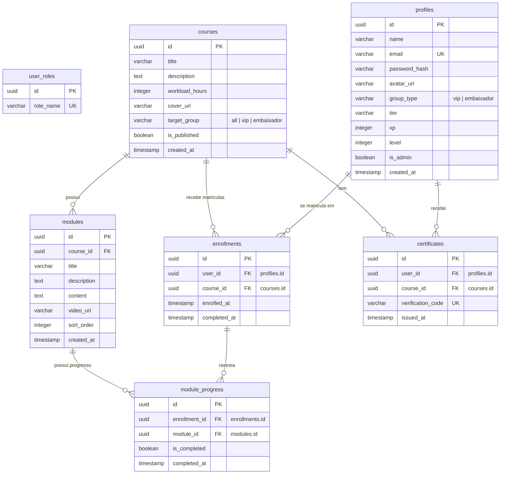

# 🗄️ Modelagem do Banco de Dados

A persistência de dados é estruturada no **PostgreSQL** e gerenciada através do **Prisma ORM** com forte integridade referencial, índices de desempenho para otimização de consultas e relações bem mapeadas.

---

## 🗺️ 1. Diagrama de Relacionamentos (ERD)

---

## 🗄️ 2. Estrutura Detalhada das Tabelas

### A. Tabela `profiles` (`@@map("profiles")`)
Armazena as credenciais de autenticação corporativa e informações gamificadas dos alunos.
*   `id`: `UUID` (Primary Key, autogerado).
*   `name`: `VARCHAR` (Nome do aluno).
*   `email`: `VARCHAR` (Unique, usado para autenticação tradicional e Google OAuth).
*   `password_hash`: `VARCHAR` (Senha encriptada usando bcrypt).
*   `avatar_url`: `VARCHAR` (Nulo por padrão, armazena iniciais do usuário ou URL do avatar personalizado).
*   `group_type`: `VARCHAR` (Padrão: `'embaixador'`, valores: `'vip'` ou `'embaixador'`).
*   `tier`: `VARCHAR` (Padrão: `'Embaixador Voice'`).
*   `xp`: `INTEGER` (XP total acumulado para a gamificação, padrão: 0).
*   `level`: `INTEGER` (Nível acadêmico atual do aluno, padrão: 1).
*   `is_admin`: `BOOLEAN` (Indica privilégios de administrador da plataforma, padrão: `false`).
*   `created_at`: `TIMESTAMP WITH TIME ZONE` (Padrão: `NOW()`).

### B. Tabela `courses` (`@@map("courses")`)
*   `id`: `UUID` (Primary Key).
*   `title`: `VARCHAR` (Nome do curso).
*   `description`: `TEXT` (Resumo em HTML ou texto puro).
*   `workload_hours`: `INTEGER` (Carga horária total em horas, padrão: 0).
*   `cover_url`: `VARCHAR` (URL da imagem de capa).
*   `target_group`: `VARCHAR` (Restrição de acesso. Valores: `'all'`, `'vip'`, `'embaixador'`).
*   `is_published`: `BOOLEAN` (Visibilidade pública para os alunos, padrão: `false`).
*   `created_at`: `TIMESTAMP WITH TIME ZONE` (Padrão: `NOW()`).

### C. Tabela `modules` (`@@map("modules")`)
Representa as aulas sequenciais vinculadas a um curso específico.
*   `id`: `UUID` (Primary Key).
*   `course_id`: `UUID` (Foreign Key -> `courses.id`, deletado em cascata).
*   `title`: `VARCHAR` (Título da aula).
*   `description`: `TEXT` (Breve introdução).
*   `content`: `TEXT` (Rich text/Leitura opcional da aula).
*   `video_url`: `VARCHAR` (Link do reprodutor do YouTube ou Vimeo).
*   `sort_order`: `INTEGER` (Número da sequência da aula, padrão: 0).
*   `created_at`: `TIMESTAMP WITH TIME ZONE` (Padrão: `NOW()`).

### D. Tabela `enrollments` (`@@map("enrollments")`)
Matrícula e vínculo do aluno em um curso específico.
*   `id`: `UUID` (Primary Key).
*   `user_id`: `UUID` (Foreign Key -> `profiles.id`, deletado em cascata).
*   `course_id`: `UUID` (Foreign Key -> `courses.id`, deletado em cascata).
*   `enrolled_at`: `TIMESTAMP WITH TIME ZONE` (Padrão: `NOW()`).
*   `completed_at`: `TIMESTAMP WITH TIME ZONE` (Data final da conclusão completa do curso, nulo caso incompleto).
*   **Restrição única**: `@@unique([userId, courseId])` - Garante apenas uma matrícula ativa por aluno em cada curso.

### E. Tabela `module_progress` (`@@map("module_progress")`)
Rastreamento do status de conclusão individual para cada aula/módulo do curso.
*   `id`: `UUID` (Primary Key).
*   `enrollment_id`: `UUID` (Foreign Key -> `enrollments.id`, deletado em cascata).
*   `module_id`: `UUID` (Foreign Key -> `modules.id`, deletado em cascata).
*   `is_completed`: `BOOLEAN` (Padrão: `false`).
*   `completed_at`: `TIMESTAMP WITH TIME ZONE` (Nulo por padrão).
*   **Restrição única**: `@@unique([enrollmentId, moduleId])` - Impede duplicidade de logs de conclusão para um mesmo módulo.

### F. Tabela `certificates` (`@@map("certificates")`)
Certificados digitais gerados após a conclusão de 100% dos módulos do curso.
*   `id`: `UUID` (Primary Key).
*   `user_id`: `UUID` (Foreign Key -> `profiles.id`, deletado em cascata).
*   `course_id`: `UUID` (Foreign Key -> `courses.id`, deletado em cascata).
*   `verification_code`: `VARCHAR` (Unique, código alfanumérico gerado no formato `SURI-AC-[HEX]`).
*   `issued_at`: `TIMESTAMP WITH TIME ZONE` (Padrão: `NOW()`).

---

## 🔒 3. Integridade e Segurança de Dados (RLS e Restrições)

*   **Deletes em Cascata**: Assegurados no nível do banco via Prisma (Ex: Deletar um curso remove automaticamente todos os módulos vinculados, matrículas e progressos relacionados para evitar dados órfãos).
*   **Restrições Únicas (Unique Indexes)**: Evitam inconsistências lógicas em solicitações simultâneas de conclusão de aula e duplicação de códigos de verificação pública de certificados.
